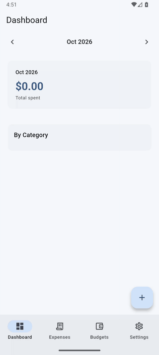

# Expense Tracker

[](https://github.com/hendra-marihot/flutter-expense-tracker/actions/workflows/ci.yml)
[](LICENSE)

A Flutter expense tracker that shows how I structure a production Flutter app: feature-first Clean Architecture, Riverpod for reactive state, and Drift for a typed local database. The scope is small on purpose. The point is the structure, not the feature list.



## Why these libraries

**Riverpod instead of Bloc.** The data here is reactive. Expenses stream from SQLite, the dashboard derives from those streams, and settings must be ready before the first frame. Riverpod covers all three: `StreamProvider` for database watchers, `Provider<AsyncValue<T>>` for derived state, and `ProviderScope.overrides` for preloading. Bloc would need more ceremony for the same result.

**Drift instead of sqflite.** I wanted reactive queries that re-emit when rows change, typed table definitions, and `insertOnConflictUpdate` for budget upserts. sqflite leaves all of that to hand-written code. Drift generates it.

**go_router with `StatefulShellRoute`.** Four tabs need to keep their state across switches, and the add-expense form has to open over the bottom bar. `StatefulShellRoute.indexedStack` handles the first. Attaching `/add-expense` to the root navigator handles the second.

## Architecture

Each feature has three layers. Domain is pure Dart. Data implements the domain interfaces. Presentation watches providers.

```
lib/
├── core/
│   ├── database/        # Drift tables, AppDatabase, generated code
│   ├── theme/           # Material 3 light/dark with seed color
│   ├── router/          # GoRouter + StatefulShellRoute
│   └── extensions/      # Currency and date formatting
└── features/
    ├── expenses/        # CRUD, category system, swipe-to-delete
    ├── budgets/         # Per-category monthly limits with upsert
    ├── dashboard/       # Aggregated monthly view, chart, breakdown
    └── settings/        # Currency, dark mode, SharedPreferences
        each with: data/ → domain/ → presentation/
```

Data flows one way:

```
┌──────────┐    watch()     ┌──────────────┐   StreamProvider   ┌──────────────┐
│  Drift   │ ──────────────>│  Repository  │ ─────────────────> │   Riverpod   │
│  SQLite  │   reactive     │  (interface) │   reactive stream  │   Provider   │
└──────────┘   stream       └──────────────┘                    └──────┬───────┘
                                                                       │ ref.watch
                                                                ┌──────▼───────┐
                                                                │   Widget UI  │
                                                                └──────────────┘
```

When a row changes, Drift's `watch()` emits, the repository stream updates, and Riverpod rebuilds only the widgets that depend on it. No manual `notifyListeners()`, no event bus.

## Decisions worth reading

**Deterministic budget IDs.** A budget's primary key is `{category}_{year}_{month}`, not a UUID. `insertOnConflictUpdate()` then handles create-or-update with no lookup query. See [`budget_repository.dart`](lib/features/budgets/data/budget_repository.dart).

**Settings loaded before the first frame.** SharedPreferences is async, but theme and currency are needed at once. `main()` loads settings before `runApp` and injects them through `ProviderScope.overrides`. No spinner, no theme flash. See [`main.dart`](lib/main.dart) and [`settings_providers.dart`](lib/features/settings/presentation/settings_providers.dart).

**`Provider<AsyncValue<T>>` for derived state.** The dashboard summary derives from monthly expenses. A `StreamProvider` that watches another `StreamProvider` double-wraps the async state. `dashboardSummaryProvider` is a plain `Provider` that maps the upstream `AsyncValue` with `whenData()`. One level of async, clean error propagation. See [`dashboard_providers.dart`](lib/features/dashboard/presentation/dashboard_providers.dart).

**Safe enum parsing.** Categories are stored as text. `EnumName.byName()` throws on unknown values, which breaks the app the day a category is renamed. Every mapping uses `firstWhere` with a fallback to `ExpenseCategory.other`. See [`expense_local_data_source.dart`](lib/features/expenses/data/expense_local_data_source.dart).

**Single-pass aggregation.** Total, per-category breakdown and daily spending come from one loop over the expense list, not three. See [`dashboard_providers.dart`](lib/features/dashboard/presentation/dashboard_providers.dart).

## Tests

55 tests. Most cover providers, repositories and data mapping. Two widget tests cover `MonthSelector` and `BudgetProgressBar`.

- Provider tests use `ProviderContainer` with overrides. No widget tree needed.
- Repository tests run against an in-memory Drift database (`AppDatabase.forTesting`).
- Stream tests use `container.listen()` to start the subscription. `container.read()` alone hangs on streams.
- Repository interfaces are mocked with mocktail.

CI runs `flutter analyze --fatal-infos`, `flutter test` and `dart format --set-exit-if-changed` on every push.

Screens have no widget tests yet. Form validation, empty states and the swipe-to-delete flow are the next targets.

## Known gaps

- **`ExpenseCategory` imports Flutter.** It carries `IconData` and `AppColors`, so the domain layer is not pure Dart. The fix is to move icon and color to a presentation-side mapping.
- **Unused dependencies.** `riverpod_annotation`, `riverpod_generator` and `collection` are declared but not used. Either adopt `@riverpod` code generation or remove them.
- **No undo on swipe-to-delete.** The `Dismissible` deletes at once. A production app needs a SnackBar with undo.
- **No screen-level widget tests.** See above.

## Run it

```bash
flutter pub get
dart run build_runner build --force-jit
flutter run
```

Needs Dart 3.8+. CI uses Flutter 3.38. Run tests with `flutter test`.

## Related repositories

Each repo in this set covers one area of mobile engineering.

| Repository | Focus |
|---|---|
| [compose-newsreader](https://github.com/hendra-marihot/compose-newsreader) | Multi-module Android, Hilt, Room, offline-first |
| [android-design-system](https://github.com/hendra-marihot/android-design-system) | Compose component library, design tokens |
| [compose-performance-lab](https://github.com/hendra-marihot/compose-performance-lab) | Compose performance anti-patterns and fixes |
| [kmp-currency-converter](https://github.com/hendra-marihot/kmp-currency-converter) | Kotlin Multiplatform, shared business logic |
| **flutter-expense-tracker** (this repo) | Clean Architecture, Riverpod, Drift, Material 3 |
| [flutter-ui-toolkit](https://github.com/hendra-marihot/flutter-ui-toolkit) | Reusable widgets, shimmer, adaptive layouts |
| [flutter-platform-bridge](https://github.com/hendra-marihot/flutter-platform-bridge) | Platform channels, native interop |
| [mobile-ci-cd-templates](https://github.com/hendra-marihot/mobile-ci-cd-templates) | CI/CD, release automation |

## License

Copyright 2026 Hendra Marihot. Licensed under the [Apache License 2.0](LICENSE).
